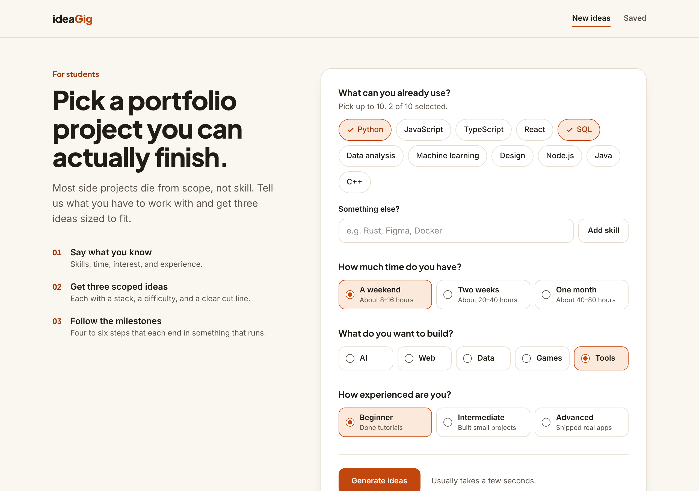
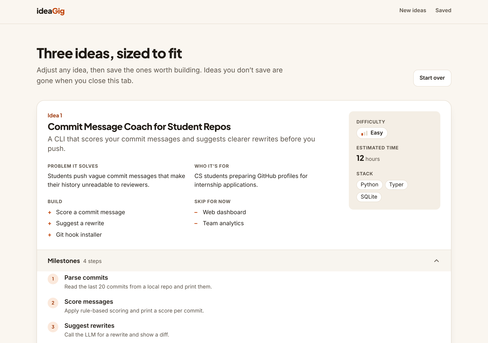
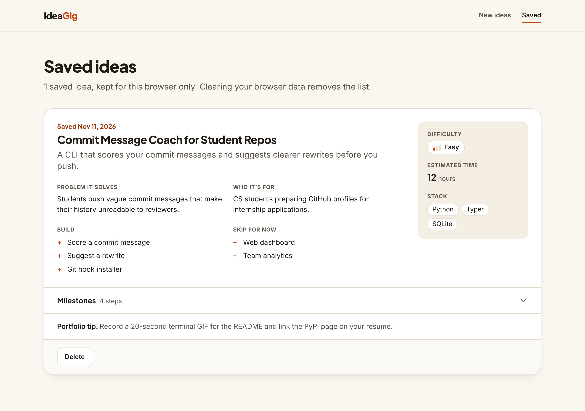
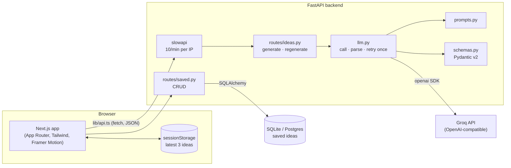

# ideaGig

Pick a portfolio project you can actually finish.

## The problem

Students know they need portfolio projects, but choosing one is hard. Ideas found online are either too vague ("build a to-do app") or far too big for the time available. Most side projects die from scope, not from lack of skill.

ideaGig asks four questions — your skills, your time, your interest area, and your experience — and returns **three scoped project ideas**. Each one comes with a stack, a difficulty, a build list, a skip list, and step-by-step milestones.

## Features

- Form with skill chips (11 suggestions plus custom entries, max 10) and radio groups for time, interest, and experience.
- Three ideas per request. Each has a title, pitch, problem, target users, difficulty, estimated hours, stack, scope in, scope out, 4–6 milestones, and a portfolio tip.
- Per-idea actions: **Make harder**, **Make easier**, **Swap stack**, **Save**.
- Saved ideas page with delete and undo. Each browser has its own private list, with no sign-up.
- LLM output is validated against a strict schema. One automatic retry on bad output.
- Rate limiting (10 requests/min per IP on idea routes, 30/min on saved writes), CORS locked to one origin, and a length limit on every text field.
- CI on every push and pull request (GitHub Actions).
- Accessible: labelled controls, visible focus rings, full keyboard navigation, `prefers-reduced-motion` support.

## Screenshots

Captured from the running app. The ideas shown are sample data, not live model output.

**Form**



**Results**



**Saved**



## Architecture



**Request flow for "Generate ideas":**

1. The form posts `GenerateRequest` to `POST /api/ideas/generate`.
2. `prompts.py` builds the prompt (inputs, JSON schema, rules).
3. `llm.py` calls Groq in JSON mode, strips code fences, and validates the reply with Pydantic.
4. If the reply is invalid, it retries once with the error appended. A second failure returns HTTP 502.
5. The frontend stores the three ideas in `sessionStorage` and routes to `/results`.

### Repository layout

```
backend/
  app/
    main.py        FastAPI app, CORS, health route
    config.py      Settings (pydantic-settings)
    schemas.py     Request/response models
    llm.py         Provider call, JSON parsing, retry
    prompts.py     Prompt templates
    db.py          SQLAlchemy model and session
    ratelimit.py   slowapi limiter
    routes/        ideas.py, saved.py
  tests/           pytest suite (no network)
frontend/
  app/             page.tsx (form), results/, saved/, layout.tsx, globals.css
  components/      IdeaForm, IdeaCard, MilestoneList, Skeleton, Button, SiteNav, motion
  lib/             api.ts, types.ts, session.ts, client-id.ts
  __tests__/       Vitest + React Testing Library
docker-compose.yml
render.yaml        Render Blueprint (backend)
.github/workflows/ci.yml
```

## API

| Method | Path | Body | Returns |
|---|---|---|---|
| `GET` | `/health` | — | `{ "status": "ok" }` |
| `POST` | `/api/ideas/generate` | `GenerateRequest` | `IdeaResponse` (exactly 3 ideas) |
| `POST` | `/api/ideas/regenerate/{idea_id}` | `{ "mode": "harder" \| "easier" \| "swap_stack", "idea": Idea }` | one `Idea` |
| `POST` | `/api/saved` | `Idea` | `SavedIdea` (201; 200 if already saved; 409 at 50 saved) |
| `GET` | `/api/saved` | — | `SavedIdea[]`, newest first |
| `DELETE` | `/api/saved/{id}` | — | 204, or 404 |

The three `/api/saved` routes require an `X-Client-Id` header: 16–64 characters of `A–Z a–z 0–9 _ -`. The frontend creates one per browser. Each id has its own list.

Interactive docs are at `http://localhost:8000/docs` when the backend is running.

**Error codes:** `409` saved list is full · `422` invalid input or missing client id · `429` rate limited (ours or Groq's) · `502` the model failed twice or Groq is unreachable · `503` `GROQ_API_KEY` is not set.

## Environment variables

| Variable | Used by | Required | Default | Purpose |
|---|---|---|---|---|
| `GROQ_API_KEY` | backend | yes | — | Groq API key. Without it, idea routes return 503. |
| `LLM_MODEL` | backend | no | `openai/gpt-oss-120b` | Groq model ID. Must support JSON mode. |
| `DATABASE_URL` | backend | no | `sqlite:///./ideagig.db` | SQLAlchemy URL. Postgres URLs work as issued by Render. |
| `FRONTEND_ORIGIN` | backend | yes in production | `http://localhost:3000` | The single origin allowed by CORS. No trailing slash. |
| `NEXT_PUBLIC_API_URL` | frontend | yes in production | `http://localhost:8000` | Base URL of the backend. Baked in at build time. |

Templates: [`backend/.env.example`](backend/.env.example), [`frontend/.env.example`](frontend/.env.example).

### About the default model — please verify

The brief asked for a current Llama instruct model on Groq as the default. When this was built (November 2026):

- Web search results reported that Groq's deprecations page lists `llama-3.3-70b-versatile` and `llama-3.1-8b-instant` as **shut down on 16 August 2026**, with `openai/gpt-oss-120b` and `qwen/qwen3.6-27b` named as replacements.
- Groq's own docs (`console.groq.com`) could **not** be opened directly from the build environment, so this was not confirmed first-hand. No request was made to Groq with a real key either.

Because a retired default would break the app on first run, the default is `openai/gpt-oss-120b` — Groq's stated replacement, not a Llama model. **Before deploying, check [Groq's model list](https://console.groq.com/docs/models).** If a Llama model you prefer is listed there, set `LLM_MODEL` to its ID. No code change is needed.

## Local setup

Requirements: Python 3.11+, Node.js 20+, and a [Groq API key](https://console.groq.com/keys).

### Backend

```bash
cd backend
python -m venv .venv
source .venv/bin/activate          # Windows: .venv\Scripts\activate
pip install -r requirements.txt
cp .env.example .env               # then add your GROQ_API_KEY
uvicorn app.main:app --reload --port 8000
```

### Frontend

```bash
cd frontend
npm install
cp .env.example .env.local
npm run dev                        # http://localhost:3000
```

### Docker Compose (both at once)

```bash
GROQ_API_KEY=your_key docker compose up --build
```

Frontend on `http://localhost:3000`, API on `http://localhost:8000`. Saved ideas persist in the `ideagig-data` volume.

## Tests

```bash
# Backend — no network. The OpenAI client is replaced by a fake.
cd backend && pytest

# Frontend — Vitest + React Testing Library. Framer Motion is mocked.
cd frontend && npm test
npm run lint && npm run typecheck
```

The same checks run in GitHub Actions (`.github/workflows/ci.yml`).

Backend tests cover schema validation, JSON parsing (valid, fenced, malformed, wrong count), every route's status codes, the retry path, both kinds of rate limit, and that info logs hold no user input or key.

## Deployment

Deploy the backend first. The frontend needs its URL.

### Backend on Render

**Quick path:** in Render choose **New → Blueprint** and pick this repository. [`render.yaml`](render.yaml) fills in the settings below and asks for the secret values. The Blueprint file has not been test-applied on Render; if it is rejected, use the manual steps.

**Manual path:**

1. Push this repository to GitHub.
2. In Render: **New → Web Service**, and connect the repository.
3. Settings:
   - **Root Directory:** `backend`
   - **Runtime:** Docker (Render picks up `backend/Dockerfile`)
   - **Health Check Path:** `/health`
4. Environment variables:
   - `GROQ_API_KEY` — your key
   - `FRONTEND_ORIGIN` — your Vercel URL, e.g. `https://ideagig.vercel.app` (set after the Vercel step; no trailing slash)
   - `LLM_MODEL` — optional
   - `DATABASE_URL` — see below
5. Deploy, then open `https://<your-service>.onrender.com/health`. It should return `{"status":"ok"}`.

**Storage on Render.** The container filesystem is temporary, so the default SQLite file is erased on every deploy or restart. To keep saved ideas, either:

- create a **Render Postgres** database and set `DATABASE_URL` to its *Internal Database URL* (the Postgres driver is already installed and tables are created at startup), or
- attach a **persistent disk** mounted at `/data` and set `DATABASE_URL=sqlite:////data/ideagig.db`.

### Frontend on Vercel

1. In Vercel: **Add New → Project**, and import the repository.
2. Set **Root Directory** to `frontend`. The framework preset (Next.js) is detected.
3. Add the environment variable `NEXT_PUBLIC_API_URL` = your Render URL, e.g. `https://ideagig-api.onrender.com` (no trailing slash).
4. Deploy.
5. Go back to Render and set `FRONTEND_ORIGIN` to the Vercel URL. Render redeploys.

`NEXT_PUBLIC_API_URL` is read at build time. If you change it, redeploy the frontend.

CORS allows exactly one origin, so Vercel preview deployments (which get their own URLs) cannot call the production API.

## Design decisions

Where the brief was open, the simplest option was chosen.

- **Regenerate sends the full idea in the body.** Generated ideas are never stored on the server, so `POST /api/ideas/regenerate/{idea_id}` needs the idea itself. The `idea_id` in the path must match `idea.id` in the body (400 otherwise). This keeps the backend stateless and means unsaved ideas leave no trace.
- **A regenerated idea gets a new id.** It is a different idea, so it can be saved alongside the original.
- **The server assigns ids.** Any id in the model's reply is ignored.
- **Form → results goes through `sessionStorage`.** The form stores the API response and routes to `/results`. Nothing is put in the URL, and a refresh keeps the ideas. They are gone when the tab closes.
- **Saved ideas are private per browser, without accounts.** The frontend creates a random id, keeps it in `localStorage`, and sends it as `X-Client-Id`. The backend only lists and deletes rows with that id. This is not authentication: anyone who obtains the id can read that list, and clearing browser data or switching browser starts a new, empty one. Real accounts would be the next step if lists must follow a person.
- **Upgrading from the first release.** Saved ideas used to be shared. On startup the backend adds the `owner_id` column if it is missing. Rows saved before the change have no owner and are no longer shown to anyone; they stay in the database.
- **Limits.** Every text field has a maximum length (60–600 characters), a browser can save at most 50 ideas, and saved writes are limited to 30/min per IP. These stop the API being used as free storage or as an open LLM proxy.
- **No `max_tokens` on the LLM call.** Left out on purpose: the right parameter and a safe value for the default model could not be tested without a Groq key. The 30-second timeout bounds each call instead.
- **Rate limiting trusts `X-Forwarded-For`.** The Docker image runs uvicorn with `--forwarded-allow-ips='*'`, which is right behind Render's proxy. If you expose the container directly, remove that flag, or clients can fake their IP.
- **Saving is idempotent.** Saving the same idea twice returns the existing record.
- **Delete is immediate, with Undo.** Undo re-saves the idea, so it gets a new record id and date.
- **Both idea routes are rate limited** (10/min per IP each), since regenerate also calls the LLM.
- **Time budgets in the prompt:** weekend ≈ 8–16 h, two weeks ≈ 20–40 h, one month ≈ 40–80 h.
- **"Swap stack" relaxes the skills rule.** Its purpose is to try a different stack.
- **Skill rules:** 1–10 skills, each 1–40 characters, trimmed, duplicates removed case-insensitively.
- **Duplicate check:** the prompt forbids near-duplicates; the server also rejects replies where two ideas share a title.
- **Missing `GROQ_API_KEY` does not stop startup.** Health checks still pass and idea routes return a clear 503.
- **Provider code lives in one function**, `_chat()` in `backend/app/llm.py`. To switch to OpenRouter, change the base URL, the key, and the model name there.
- **Logging:** info logs record only counts, enum values, and the model name. Skill text and the API key are never logged.
- **Custom skills** are rendered as React text nodes (escaped by React). `dangerouslySetInnerHTML` is not used anywhere. In the prompt they are passed as a JSON-encoded list and marked as data.
- **Extra files beyond the brief's tree:** `Button.tsx`, `SiteNav.tsx`, `lib/session.ts`, `lib/client-id.ts`, `error.tsx`, `not-found.tsx`, `ratelimit.py`, `render.yaml`, the CI workflow, test fixtures, tool configs, and `frontend/Dockerfile` (needed by Docker Compose).
- **UI:** Tailwind only, no component library. One accent colour (`accent`, a warm orange) defined with the other tokens in `frontend/app/globals.css`. Headings use Plus Jakarta Sans; body text uses the system font.
